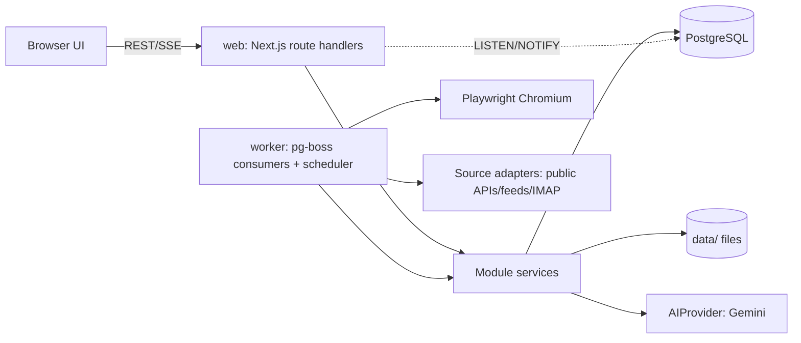
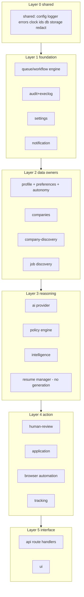

# 05 — System Architecture

## 1. Style
**Modular monolith**, single repo, single TypeScript package. Two runtime processes sharing code and DB:
1. `web` — Next.js (App Router) serving UI + REST route handlers + SSE.
2. `worker` — Node process running pg-boss workers + scheduler + browser automation. Chromium launched on demand.

PostgreSQL is the only stateful dependency (native PostgreSQL 16 inside WSL2, no Docker). Files on local disk under `data/` behind a `FileStorage` interface. Primary dev/runtime environment: **WSL2 Ubuntu 24.04**; canonical working directory is `E:\personal\career-copilot` (`/mnt/e/personal/career-copilot`).



`web` and `worker` import the same module services. Web enqueues; worker executes anything slow (AI, fetch, browser).

## 2. Layers inside every module
```
modules/<name>/
  index.ts        # PUBLIC API (only thing others may import)
  schemas.ts      # zod schemas + inferred types
  domain/         # pure logic, no I/O (heavily unit-tested)
  repo.ts         # DB access (Drizzle)
  service.ts      # orchestrates domain + repo + other modules' public APIs
  jobs.ts         # queue handler definitions (if any)
  adapters/ | infra/   # I/O implementations (HTTP, browser, LLM)
  __tests__/
```

## 3. Module dependency map (arrows = "may import")
Lower layers never import higher ones. No cycles (enforced).



Explicit allowed imports:
| Module | May import (public APIs) |
|--------|--------------------------|
| shared | — |
| settings, audit, queue | shared |
| notification | shared, settings, queue, audit |
| profile | shared, audit, settings |
| companies (entity + domains + evidence-free registry data) | shared, audit |
| **company-discovery** | shared, queue, audit, settings, companies |
| discovery (jobs) | shared, queue, audit, companies, company-discovery(read boards), profile(prefs read), policy(prefilter) |
| ai | shared, settings, audit (no domain knowledge of jobs) |
| policy | shared, settings (**no ai, no discovery**) |
| intelligence | shared, ai, profile, companies, company-discovery(read), discovery(read), policy, audit |
| resume (manager) | shared, audit, settings (**no ai, no profile**) |
| human-review | shared, queue, notification, audit |
| browser | shared, audit (no business modules; generic automation primitives + portal drivers receive plain data) |
| application | shared, queue, profile, resume, intelligence, policy, human-review, browser, notification, audit, discovery(read) |
| tracking | shared, application(read/transition API), notification, audit |
| api | any module public API |
| ui | only `/api` over HTTP (no module imports except shared types/zod schemas) |

**Company Discovery vs Job Discovery:** `company-discovery` answers "which companies exist, where is their career page/ATS board, are they alive?" and runs even with zero openings. `discovery` answers "what jobs are on the boards/sources?". The only coupling: `discovery` reads registered boards from `company-discovery` (read API) and `company-discovery` never imports `discovery`. Job-URL imports in `discovery` emit a queue event `company.propose` handled by `company-discovery`.

Circular needs (e.g. review needs to resume application workflow) are solved with **events via the queue**: review enqueues `workflow.resume` with `{workflowId}`; the `application` module registers the handler. Review never imports application.

## 4. Technology stack (final; additions require ADR)
| Concern | Choice | Notes |
|---------|--------|-------|
| Language | TypeScript 5.x strict | |
| Web | Next.js 15 App Router, React 19 | UI + route handlers |
| Styling/UI | Tailwind CSS 4 + shadcn/ui (Radix) + lucide-react | restrained design |
| Data fetching UI | TanStack Query | + SSE invalidation |
| Forms | react-hook-form + zod resolver | |
| DB | PostgreSQL ≥15 (dev: 18 or 17 docker) | |
| ORM/migrations | Drizzle ORM + drizzle-kit, `pg` driver | SQL-close, simple migrations (ADR-003) |
| Queue | pg-boss | (ADR-004) |
| Validation | zod | |
| Logging | pino | |
| AI | `@google/genai` behind `AIProvider` | |
| Browser | `playwright` (chromium only) | |
| HTML parsing | `cheerio` | job pages/feeds |
| Text extraction | — | none (no resume parsing, Q8) |
| PDF/DOCX generation | — | **none** (no resume generation, Q8). Lint bans `docx`, `pdfkit`, `pdf-lib`, `pdf-parse`, `mammoth` imports |
| IMAP | `imapflow` + `mailparser` | optional, only if user opts in (Q15); install at M13 only if opted |
| SMTP | `nodemailer` | optional |
| Telegram | plain `fetch` to Bot API | no lib |
| Password hashing | `argon2` (or node `scrypt` if native build fails) | |
| Tests | vitest, @testing-library/react, playwright test, `testcontainers` NOT used — tests use a dedicated local DB `career_copilot_test` | |
| Lint/format | eslint, prettier, dependency-cruiser | |
| Runner | `tsx` for worker/scripts | |
| Domain parsing | `tldts` | registrable-domain (eTLD+1) parsing for company/domain matching |
| HTML sanitizing | `sanitize-html` | sanitize scraped job HTML before storage/render |
| Misc | `concurrently`, `date-fns-tz` | dev:all runner; timezone formatting |

## 5. Exact initial folder structure
```
career-copilot/
├─ docs/                          # these documents
├─ drizzle/                       # generated SQL migrations (committed)
├─ data/                          # gitignored: files, resumes, screenshots, backups
├─ scripts/
│  ├─ db-reset-test.ts
│  ├─ backup.ts
│  └─ verify-env.ts
├─ fixtures/                      # CLEARLY LABELED test fixtures only
│  ├─ ats-site/                   # local fake ATS (express/static) for browser tests
│  ├─ jobs/                       # sample payloads from real ATS APIs (saved responses)
│  └─ README.md                   # "fixtures are for tests; never loaded in prod"
├─ src/
│  ├─ app/                        # Next.js App Router
│  │  ├─ (app)/                   # authenticated shell
│  │  │  ├─ dashboard/ jobs/ jobs/[id]/ companies/ companies/[id]/ recommended/ saved/
│  │  │  ├─ applications/ applications/[id]/ review/ review/[id]/ tracker/
│  │  │  ├─ resumes/ profile/ preferences/ automation/ sources/
│  │  │  ├─ notifications/ activity/ settings/ onboarding/
│  │  ├─ login/
│  │  └─ api/                     # route handlers (thin: parse→service→respond)
│  ├─ components/                 # ui primitives + feature components
│  ├─ modules/
│  │  ├─ profile/  ├─ companies/  ├─ company-discovery/  ├─ discovery/  ├─ ai/  ├─ policy/
│  │  ├─ intelligence/  ├─ resume/  ├─ human-review/  ├─ application/
│  │  ├─ browser/  ├─ tracking/  ├─ notification/  ├─ queue/  ├─ audit/  ├─ settings/
│  ├─ shared/                     # config, logger, errors, clock, ids, db, storage, redact, http
│  ├─ db/
│  │  ├─ schema/                  # one file per module group: profile.ts discovery.ts ...
│  │  └─ index.ts
│  └─ worker/
│     ├─ index.ts                 # boots pg-boss, registers handlers, scheduler, heartbeat
│     └─ registry.ts              # imports each module's jobs.ts
├─ tests/
│  ├─ e2e/                        # playwright test
│  ├─ integration/
│  └─ failure/                    # failure-injection
├─ .env.example
├─ docker-compose.yml             # optional db only
├─ drizzle.config.ts  vitest.config.ts  playwright.config.ts
├─ eslint.config.mjs  .dependency-cruiser.cjs  tsconfig.json
└─ package.json
```
npm scripts: `dev` (web), `dev:worker`, `dev:all`, `build`, `start`, `typecheck`, `lint`, `check:deps`, `test`, `test:int`, `test:e2e`, `test:failure`, `db:generate`, `db:migrate`, `db:reset:test`, `verify:env`.

## 6. Key data flows
**Company discovery:** `company.propose`/manual add/CSV → `companies` (status discovered) → user accepts → `company.detect` (career page + ATS) and `company.probe` (slug probing, user confirm) → `company_career_pages` + `company_monitors` → derived `job_sources` → scheduled `company.check`.
**Job discovery:** scheduler → `discovery.sync{sourceId}` → adapter.fetch → snapshots → normalize → dedupe → `jobs` (+events) → pre-filter → enqueue `intel.analyze{jobId}` (skipped/deferred if AI unavailable; deterministic data still visible).
**Intelligence:** analyze(JD) → `job_analyses` → `company.research{companyId}` (if stale; `SearchProvider`) → `comp.research` → `intel.evaluate{jobId}` (pure) → `policy.evaluate` → status/shortlist/notify.
**Application (L2):** shortlist → `application.create` (dedupe guard) → workflow runner steps (doc 10 §4) ↔ HITL pauses → summary approval → manual handover **or** per-application authorized submit → verify → tracking.
**Resume:** upload PDF → store original + sha256 → select per application → attach original file.

## 7. Failure domains
DB down → web returns 503 health, worker pg-boss retries connection; no data loss. Worker down → UI banner; queued jobs wait. **AI down/quota exhausted → AI tasks retry/backoff or defer; all non-AI features continue (degraded mode, doc 11 §10).** Browser crash → step failure, workflow retried from last checkpoint (never from submit). Network interruption → retryable error class, backoff.

## 9. Representing "unknown" (Q: never fabricate)
`type Unknown = { kind: 'unknown'; reason?: string }`. Domain functions that depend on optional data return tri-state results (`pass | fail | unknown`) or `Known<T> | Unknown`. DB uses NULL (or explicit `unknown` enum members for assessments). UI renders "Unknown" explicitly (never 0, "N/A", or empty). Mapper/scorers must never coerce unknown to a default value except where a doc states a flagged neutral (e.g., unknown comp scores 50 **and** is labeled "unknown — neutral score").

## 8. Real-time
SSE endpoint streams `{type, entity, id}` events fed by Postgres `LISTEN/NOTIFY` channel `app_events`. Clients invalidate TanStack queries. SSE is hint-only; correctness never depends on it.
