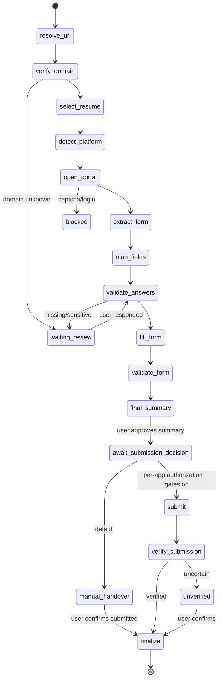

# 10 — Workflows & State Machines

All transitions: one function per machine `transition(id, to, actor, reason, evidence?)` → validates against the table below → updates row + inserts history/event row in ONE transaction → emits `app_events` NOTIFY. Invalid → `AppError('INVALID_TRANSITION')`.

## 1. Job status
States: `new, under_analysis, recommended, shortlisted, saved, rejected, expired, closed, applied, archived`.
| From | To (allowed) |
|------|--------------|
| new | under_analysis, rejected, saved, archived, closed |
| under_analysis | recommended, rejected, new (analysis failed terminal → stays visible with `status_reason`), saved, closed |
| recommended | shortlisted, saved, rejected, archived, closed, expired, under_analysis (re-eval) |
| shortlisted | applied, saved, rejected, archived, closed, expired |
| saved | shortlisted, rejected, archived, under_analysis, closed |
| rejected | new (user undo only), archived |
| expired / closed | archived, shortlisted (user reopen if listing active again) |
| applied | closed, archived |
| archived | new (user restore) |
Actors: `system` may do new→under_analysis, →closed/expired, under_analysis→recommended/rejected(only when ineligible or prefilter). `policy` may recommended→shortlisted only if autonomy allows. `user` anything allowed in table.
Rule: `applied` set only by application module upon verified/manual submission.

## 2. Human review request status
`pending → answered | approved | rejected | deferred | cancelled | expired`; `deferred → pending` (when snooze ends or user reopens); `answered/approved` terminal (create a new request to change). `pending → pending` for "investigate" (adds evidence).
On entering answered/approved: validate payload → store response → enqueue `workflow.resume{workflowId, requestId}` (singletonKey `resume:<requestId>`).
On rejected: workflow policy per category (default: application → `paused_by_user`, ask next action). On cancelled(application): application → `withdrawn`/`closed`.

## 3. Application status
States: `interested, shortlisted, preparing, awaiting_review, ready_to_submit, submitted, submission_unverified, under_review, assessment_received, interview_scheduled, interview_completed, offer_received, rejected, withdrawn, closed`.
| From | To |
|------|----|
| interested | shortlisted, preparing, withdrawn, closed |
| shortlisted | preparing, withdrawn, closed |
| preparing | awaiting_review, ready_to_submit, withdrawn, closed |
| awaiting_review | preparing (after response), ready_to_submit, withdrawn, closed |
| ready_to_submit | submitted, submission_unverified, awaiting_review (answers changed → authorization invalidated), preparing, withdrawn |
| submission_unverified | submitted (user/verification confirms), preparing (user confirms NOT submitted), closed |
| submitted | under_review, assessment_received, interview_scheduled, rejected, offer_received, withdrawn, closed |
| under_review | assessment_received, interview_scheduled, rejected, offer_received, withdrawn, closed |
| assessment_received | interview_scheduled, rejected, under_review, withdrawn, closed |
| interview_scheduled | interview_completed, rejected, withdrawn, closed |
| interview_completed | interview_scheduled (next round), offer_received, rejected, withdrawn, closed |
| offer_received | closed, withdrawn, rejected(declined by company) |
| rejected / withdrawn / closed | (terminal; user may reopen to `preparing` only from withdrawn/closed with explicit action) |
Auto transitions by system only: preparing/awaiting_review/ready_to_submit (workflow), submitted/submission_unverified (submission engine), under_review (confirmation email). Tracking statuses after submitted via system **only as suggestions** unless user enabled auto-apply for that email type. No transition to `rejected` from timeouts.

## 4. Application workflow (checkpointed step machine)
`workflow_checkpoints.step` ∈ ordered list. Each step function signature: `(ctx) => Promise<StepResult>` where `StepResult = {next: Step} | {pause: ReviewRequestSpec[]|'authorization'|'blocked'} | {done} | {fail: ErrorClass}`. Runner loop: load checkpoint (lock row `FOR UPDATE` with version) → run step → in one tx: save new `step/state/version`, write `application_tasks`, create review requests if pausing → commit → enqueue next `application.run_step` (singletonKey `wf:<id>:<step>:<version>`). Re-running a completed step is a no-op (steps are idempotent via state flags).

Steps:
1. `resolve_url` — choose official application URL (job.application_url; else listing URL). 
2. `verify_domain` — host ∈ known ATS domains list OR company verified domains; else **pause** review (category `company_legitimacy`).
3. `select_resume` — requires a user-selected resume version (`resume_attachments`); if none → pause review (`required_action=decide`, "Select a resume"). No generation, no AI selection; default version pre-suggested only.
4. `detect_platform` — `detectPlatform(url)`.
5. `open_portal` — browser; blocked detection → pause(`blocked`).
6. `extract_form` — fields (multi-page: loop until review/submit page) → persist `application_form_fields`. NO submission/next-page clicks that commit data; page transitions limited to "Next/Continue" in drivers marked `safeNavigation`.
7. `map_fields` — pure mapping + classifier + answer resolution hierarchy → `application_field_answers`. Core-category fields skip AI entirely.
8. `validate_answers` — type/length/option checks; collect all items needing review (missing/null profile data, core categories incl. EEO, ambiguous, AI suggestions) → **create review requests (one per field/issue)**; if any → pause `waiting_review`; status `awaiting_review`.
9. `fill_form` — requires all answers `approved` or `profile`-sourced non-core; fill; attach the **original** resume file.
10. `validate_form` — read back values & portal validation messages; mismatch → fail(`fill_mismatch`) → retry ≤2 else pause for user.
11. `final_summary` — build summary & `summary_hash` (answers + resume sha256 + URL); status `ready_to_submit`; user must **approve summary** (`approve-summary`) — this is the Level-2 approval.
12. `await_submission_decision` — three outcomes: (a) **manual handover** (default): open headed browser with prefilled form, workflow `paused(manual_handover)`, user submits then clicks "I submitted it" → `finalize` with `submission_source=manual_confirmed` (and optional evidence/notes); (b) **per-application authorized submit** if env `SUBMISSION_ENABLED=true` AND settings toggle on AND user authorized this `summary_hash` → `submit`; (c) user cancels/defers. There is no policy-driven path (L3 future).
13. `submit` — see §5 (M12 only; code absent before M12).
14. `verify_submission` — see §5.
15. `finalize` — transition application to `submitted`, job → `applied`, notify, schedule monitoring (if enabled).

Resume semantics: `workflow.resume` handler loads checkpoint; if status `waiting_review` and all requests for the checkpoint are resolved → set `running`, continue at stored `step` (usually `validate_answers` re-evaluation → `fill_form`). Idempotent: if status already running/completed → no-op.
Browser state is NOT persisted across pauses: on resume, re-open portal and re-extract/fill from stored answers (form field keys make this deterministic). Portal drafts used only if driver supports them safely.

## 5. Submission protocol (idempotency)
```
BEGIN
  assert application.status = ready_to_submit
  assert valid authorization (§6) with summary_hash == current summary_hash
  assert no application_submissions row in (intent,clicked,verified,unverified)   -- also enforced by partial unique index
  INSERT application_submissions(status='intent', authorization_id, intent_at)
COMMIT
-- browser: final pre-click checks (domain unchanged, form still filled)
UPDATE submission status='clicked', clicked_at   (committed BEFORE the click)
click submit
verify (wait for confirmation text/URL/DOM per driver; max 30s; then check email later)
  verified    → status='verified', evidence saved → application submitted
  not visible → status='unverified' → application.status=submission_unverified
  pre-click failure (nothing sent) → 'failed_before_click' ONLY if status was 'intent' (never clicked)
```
Rules:
- If worker crashes between 'clicked' and verify: on recovery, status 'clicked' → run `verify` only (inspect portal / confirmation); never click again. If cannot determine → `unverified`.
- Retry of submit allowed only from `failed_before_click`/`abandoned` (new row after previous is terminal-failed) or after user `resolve-unverified: retry_confirmed`.
- "Application already submitted externally": driver detects "already applied" text → treat as `verified` with evidence kind `already_applied`.
- This protocol is implemented in **M12**; before M12 no code path may click a submit control (manual handover only).

## 6. Authorization model (v1: per-application only)
`application_authorizations` kinds:
- `submission` per application: user clicks "Authorize submission" on the final summary; stores `summary_hash`; expires in 24h (configurable) or on any answer/resume/URL change. Usable only when env `SUBMISSION_ENABLED=true` and settings toggle is on.
- Legal/consent/bond/declaration: **always** per-item explicit authorization (`kind` accordingly, scope includes text hash of the declaration). Never inferred, never reusable by default.
- EEO/demographic: not an "authorization" but always a human answer (provide / decline / blank); never auto.
- **No standing authorizations or auto-submit policy in v1 (Level 3 future).** `autonomy_policies.level` max = 2.
Check function `checkSubmissionAuthorization(app): {ok:boolean, reasons[]}` is pure given loaded data. Reasons it fails: gates off, no authorization, expired, `summary_hash` mismatch, any answer not approved, any core-category field without human answer/authorization, resume sha256 mismatch, domain unverified, duplicate application. Tested exhaustively.

## 7. Source sync run
`running → succeeded | partial | failed | cancelled`. Failure increments source failures; after 5 consecutive → source status `failing` and notify; exponential schedule backoff (cap 24h). Never marks listings missing on failed/partial run.

## 8. Notification delivery
`pending → sent | failed(attempts<5 → pending with backoff) | skipped(channel disabled)`.

## 9. Worker recovery
Heartbeat every 15s. On worker start: (1) pg-boss resumes expired active jobs; (2) recovery job scans `workflow_checkpoints` with status `running` and `updated_at` older than 2 min → re-enqueue current step (unless step is `submit`, in which case run `verify_submission` only); (3) scans submissions `clicked` → verify; (4) sweeps orphaned temp browser files.
UI offline banner when `last_seen_at` > 60s.

## 10. Failure recovery matrix
| Failure | Detection | Handling |
|---------|-----------|----------|
| Browser crash | Playwright disconnect/exception `BROWSER_CRASHED` | close context, delete temp files, retry step ≤2 from `open_portal` using stored answers; after crash post-`clicked` → verify-only |
| Network interruption | fetch/navigation errors | retryable error class, backoff; workflow stays `running`/retries; after max → pause with notification, no state loss |
| AI quota exhausted / provider down | `BUDGET_EXCEEDED`, 429/503 | defer AI tasks to next window with backoff; non-AI work continues; notification (deduped) "AI quota exhausted"; application flow: AI suggestions skipped → fields go to human review instead of blocking silently |
| Partially completed application | checkpoint step + `application_field_answers.status` | resume at stored step; re-fill is idempotent (read-back first; fill only fields whose value differs); never creates a second application (dedupe_key unique) or second submit |
| Worker killed mid-step | stale `updated_at` | recovery job (§9) |
| DB interruption | tx rollback | step retried; no partial multi-table state (single tx per step result) |
| Portal layout change | `LAYOUT_CHANGED` | pause with screenshot, manual handover |
| CAPTCHA/login/403 | `detectBlock` | pause `blocked`; manual handover; never evade |
| User responds days later | n/a | request pending indefinitely; on resume re-open portal (session not persisted), re-verify domain, re-extract form and diff vs stored fields; if portal form changed materially → new review request |

## 11. Company monitor machine (company-discovery)
Company `discovery_status`: `discovered → registered → monitoring ⇄ paused`; any → `excluded` (reversible to `registered`). `monitoring` requires ≥1 `company_career_pages.status='confirmed'` **or** user-chosen "monitor domain only" (checks career page presence). Probe candidates: `pending_confirmation → confirmed|rejected`. Check run: `queued → running → succeeded|failed|blocked_by_robots|unreachable`; 5 consecutive failures → monitor `failing` + deduped notification; `unreachable` never flips a company to closed/excluded automatically.

## 10. Diagram

