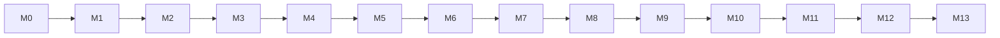

# 17 — Implementation Plan (Ordered Milestones)

Rules: one milestone at a time, in order. Each lists **Read** (docs to load), **Build**, **Tests (must pass)**, **Done when**. After each: commit + Milestone Report (doc 00 §6). Dependency order is strict; do not start M(n+1) until M(n) is green.

## M0 — Scaffold & environment
Read: 00, 01, 05, 15§1, 16. Build:
- `npm init`; install deps from doc 05 §4 needed *now* (next, react, typescript, tailwind, shadcn init, drizzle-orm, drizzle-kit, pg, zod, pino, vitest, eslint, prettier, dependency-cruiser, tsx, concurrently, @playwright/test). tsconfig strict; alias `@/`.
- Folder skeleton per doc 05 §5 with `index.ts` stubs for modules (empty exports, no fake logic).
- ESLint boundary rules + `.dependency-cruiser.cjs` encoding the import table in doc 05 §3; `npm run check:deps`.
- `.env.example`, `docker-compose.yml`, `scripts/verify-env.ts`.
- Fill audit TODOs in doc 01 (wsl, pg_isready, disk/RAM, playwright install).
Tests: a trivial unit test, a depcruise test that a forbidden import fails (create temp file in test).
Done when: `npm run typecheck && lint && check:deps && test` green; `npm run dev` serves a blank shell.

## M1 — Foundation: shared, DB, queue, auth, shell
Read: 05, 08 (infra tables), 09 (auth/system), 13§2–4,6, 14§2. Build:
- `shared/*` (config, logger+redact, errors, clock, ids, db, storage, http `safeFetch`).
- Drizzle schemas for infra tables + `system_settings`, `audit_logs`(+immutable trigger), `auth_*`, `files`, `agent_execution_logs`, `worker_heartbeats`, `notifications`(+deliveries). First migration.
- `queue` module (pg-boss wrapper, handler wrapper, heartbeat), `worker/index.ts`, `audit`, `settings`, `notification` (in_app only).
- Auth routes, middleware, CSRF/Origin/Host checks, security headers; `/api/health`; `/api/events` SSE with LISTEN/NOTIFY.
- UI shell: sidebar, topbar, worker status pill, login/setup pages, empty dashboard that renders real counts (zeros).
Tests: T-REDACT, safeFetch SSRF tests, T-DB-1 (partial), T-Q-1, auth lockout, CSRF/Host, health API, heartbeat→banner.
Done when: setup passcode → login → shell shows "Worker online"; kill worker → "offline" within 90s.

## M2 — Profile, preferences, autonomy, reusable answers
Read: 03 PRF/PRE, 08§2, 09 Profile, 11§5, 14 profile/onboarding/automation(form only). Build: tables + migration, profile module (verified snapshot API, revisions, completeness), preferences, autonomy (+history, confirm-on-enable), reusable answers (authorized_at), APIs, UI for onboarding wizard/profile/preferences/automation policy form, settings page (timezone, weights validator).
Resume import: upload + text extraction (pdf-parse/mammoth) → draft table; **AI parse deferred to M5** (draft shows extracted raw text with manual "add item" until then; document this limitation).
Tests: completeness, snapshot excludes unverified, revision diff, autonomy confirm rule, reusable-answer constraint, API tests, E2E-1, E2E-2.
Done when: full profile editable and persisted; `getVerifiedSnapshot` tested.

## M3 — Job domain & manual/URL import, normalization, dedupe, lifecycle
Read: 03 DSC, 07 discovery/companies, 08§3, 10§1, 14 jobs. Build: companies, discovery tables, pure domain (normalize, comp parser, dedupe) with T-NORM/T-COMP/T-DEDUP first, job state machine, `importManual`, `importUrl` (JSON-LD parse + safeFetch + robots), jobs list/detail UI (overview, history), search (tsvector), filters.
Tests: all T-NORM/T-COMP/T-DEDUP/T-SM(job), T-DSC-2 using manual imports, API tests.
Done when: user can paste/import a job, see canonical normalized record, duplicates flagged, status transitions logged.

## M4 — Source adapters & discovery scheduler
Read: 03 DSC, 07 adapters, 12 n/a, 15 T-DSC. Build: adapter interface/registry, greenhouse, lever, ashby, smartrecruiters, rss_feed, rate limiter, sync runner with isolation, scheduler (pg-boss cron per source), listing-missing logic, sources UI (add wizard w/ test fetch, status, run now), email_alert adapter (IMAP read-only) if IMAP configured.
**Verify each public endpoint live**, save trimmed real responses to `fixtures/jobs/`. If an endpoint changed, update doc 07.
Pre-filter policy hook (excluded companies etc.) via policy module stub **only after M6?** → implement minimal pure prefilter in discovery using `job_preferences` (documented), replaced by policy engine in M6.
Tests: T-DSC-1..4, scheduler, 429 handling.
Done when: real board (user supplies a Greenhouse board token) syncs into jobs; failing source isolated; UI shows runs.

## M5 — AI layer & job analysis
Read: 11 all, 03 INT-1, 08 job_analyses/ai_*. Build: AIProvider, AIService pipeline (budget, cache, rate limit, correction, semantic validators), Gemini provider (verify current models/limits from official docs → record in doc 11 §9), FakeProvider (test only + lint ban from prod), prompts jd_analysis/resume_parse, `intel.analyze` handler, resume-import AI draft (profile module via ai public API → drafts), AI usage page.
Tests: T-AIVAL, T-AI-1/4/7, injection fixture, invalid output flows; `ai:smoke` script manual.
Done when: new job → analyzed (FakeProvider in tests; real Gemini in manual smoke) with structured rows; unchanged JD skipped.

## M6 — Evaluation: eligibility, scoring, policy engine, recommendations
Read: 03 INT/POL, 07 policy/intelligence, 08§4–5, 10, 14 job evaluation tab. Build: pure domain (eligibility, scoring, risk, recommendation, skills alias), `role_match` task, evaluation persistence + history, policy engine (rules-as-data, core rules, decisions persisted), policy rules UI + simulate, job status automation (recommended/shortlisted/rejected via policy+autonomy), recommended page, notifications for high-priority jobs.
Tests: T-ELIG (+property), T-SCORE, T-RISK, T-REC, T-POL, T-INT-1, E2E-3 (partial).
Done when: job detail shows explainable evaluation; ineligible never recommended (property test).

## M7 — Company & compensation intelligence
Read: 03 INT-4..6, 08 evidence/company_research/salary_evidence, 07 companies, 11 company_synthesis/comp_estimate. Build: evidence store (immutable), research collectors (official site fetch via safeFetch, DNS, career page detection, news via configurable provider — **ask user which news/search API they want; default: skip, mark unknown**), legitimacy checklist (pure), synthesis task with citation validation, comp intelligence (disclosed from job, reported only if user-added evidence, estimated flagged), company UI, provenance badges.
Tests: T-RISK expansions, citation validator, comp estimate never labeled disclosed, UI badge tests.
Done when: company page shows evidence list + legitimacy checks + uncertainty; no "legitimate/fraud" labels.

## M8 — Human review center & workflow engine
Read: 03 HIT, 10§2,§4,§9, 08§8, 14 review. Build: workflow_checkpoints, runner (step machine skeleton with test steps), review module (create/respond/defer/cancel/investigate), `workflow.resume` handler, recovery job, review UI + notifications (+Telegram optional channel), reusable save with confirm.
Tests: T-HIT-1/2, **T-REC-1/2/3**, response validation, E2E for review answer.
Done when: demonstrable pause → process restart → answer → resume at same step (automated).

## M9 — Resume intelligence
Read: 03 RES, 07 resume, 08§6, 11 resume_rewrite, 14 resumes. Build: master model generator, selection, claims+validator, rewrite task w/ deterministic guards, templates (classic/compact), PDF (Playwright) + DOCX, versions/diff/approve, associations.
Tests: T-RESVAL (fabrication cases), render smoke (PDF opens, DOCX unzip contains text), E2E-4.
Done when: tailored resume validated, previewed, approved; fabricated claim blocks approval.

## M10 — Application preparation (prepare-only)
Read: 03 APP-1..7, 07 application/browser, 10§4 steps 1–12, 12 all, 11 form_answer_draft/ambiguity. Build: browser module (session, errors, screenshots), drivers greenhouse/lever/ashby/generic with extract+fill (submit disabled flag), fixture ATS site, mapping + answer hierarchy + category classifier, validate_answers → review requests, fill/validate_form, application UI (stepper, answers table, form tab, logs/screenshots), final summary + summary_hash.
Tests: T-MAP, fixtures-based browser tests (extract/fill/readback, honeypot, layout change, captcha pause), E2E-5.
Done when: against fixture site, application reaches `ready_to_submit` with correct fills; sensitive fields paused; **no submit code path reachable** (feature flag `SUBMISSION_ENABLED=false` hard-coded false until M11).

## M11 — Controlled execution (submission)
Read: 10§5–6, 13§8, 12 verify, 15§5. Build: authorization module (per-app + standing), `checkSubmissionAuthorization`, submission protocol (intent→clicked→verify), SubmitToken guard, verification, unverified resolution UI, already-applied handling, submission recovery, enable `SUBMISSION_ENABLED` config (default false; user must set true in env AND settings).
Tests: T-AUTH matrix, T-APP-1, failure-injection suite incl. submit-timeout invariant ≤1 POST, E2E-6, E2E-7. Manual dry-run checklist (doc 15§7) → hand to user before any real submission; do NOT submit to real portals during development.
Done when: all failure tests green; user performs checklist.

## M12 — Tracking, monitoring, notifications, dashboard
Read: 03 TRK/NOT, 07 tracking/notification, 14 dashboard/tracker/notifications. Build: tracker UI (kanban+table), events/notes/contacts/interviews, IMAP monitor + classifier (rules first, AI fallback, suggestions flow), Telegram + SMTP channels, digest, dedupe, deadline reminders, dashboard (real queries only), offline gap detection.
Tests: email classifier fixtures, notification dedupe, E2E-8, E2E-10.
Done when: dashboard numbers equal DB truth; no auto-reject inference.

## M13 — Hardening & release
Read: 13§11, 15 all, 16. Build/Do: security review pass against doc 13 checklist, DB integrity review, performance check (10k jobs seed script labeled dev-only), full failure suite, a11y e2e, backup/restore scripts + test, Windows auto-start docs, final docs sweep (every doc matches reality), README quick-start.
Tests: everything. Report honestly what is verified vs not.
Done when: all gates green; manual checklist complete; known limitations listed.

## Milestone→doc quick map
| M | Primary docs |
|---|--------------|
| 0-1 | 05, 13, 16 |
| 2 | 03, 08, 14 |
| 3-4 | 07, 08, 10 |
| 5-7 | 11, 07, 08 |
| 8 | 10, 03 |
| 9 | 07, 11 |
| 10-11 | 10, 12, 13, 15 |
| 12-13 | 03, 14, 15, 16 |

## Multi-agent split (optional)
Only after M1: Agent A (discovery M3–M4), Agent B (profile UI M2 pieces) — never touching same files; the lead owns `src/db/schema/*`, `package.json`, `.dependency-cruiser.cjs`, queue names, and merges migrations serially. Default recommendation: **single agent, sequential**, for small models.
