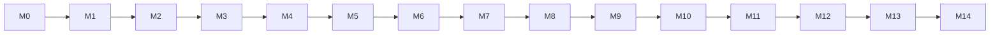

# 17 — Implementation Plan (Ordered Milestones)

Rules: one milestone at a time, in order. Each lists **Read**, **Build**, **Tests (must pass)**, **Done when**. After each: commit + Milestone Report (doc 00 §6). Do not start M(n+1) until M(n) is green. Precedence: [19-user-decisions](19-user-decisions.md).

Autonomy levels: **L1** discovery/evaluation (M3–M8) → **L2** preparation with approval (M10–M12) → L3 auto-submit **not implemented** (future).

## M0 — WSL2 environment & scaffold
Read: 00, 01, 05, 15§1, 16. Build:
- Verify/finish environment per doc 16 §1–3 (user runs sudo steps; agent prints exact commands and waits): nvm Node 22 in WSL (not Windows node), PostgreSQL 16 native, Playwright Chromium + deps, WSLg headed-browser check. Record results in doc 01 §5.
- Resolve Q13 with user, then place working tree at `~/dev/career-copilot`.
- `npm init`; deps from doc 05 §4 needed now; strict tsconfig; alias `@/`; folder skeleton (doc 05 §5) with empty `index.ts` per module (no fake logic); ESLint boundary rules + `.dependency-cruiser.cjs` from doc 05 §3; `.env.example`, `scripts/verify-env.ts`.
Tests: trivial unit test; depcruise forbidden-import test; `verify:env` test.
Done when: `npm run typecheck && lint && check:deps && test` green in WSL; blank shell served; `psql` connects to `career_copilot`.

## M1 — Foundation: shared, DB, queue, auth, shell
Read: 05, 08§9 infra, 09 auth/system, 13§2–4,6, 14§2. Build: `shared/*` (config, logger+redact, errors, clock, ids, db, storage, `safeFetch`, `Unknown<T>` helpers); infra tables + first migration; `queue` (pg-boss), worker bootstrap + heartbeat, `audit`, `settings`, `notification` (in_app); auth + CSRF/Origin/Host + headers; `/api/health`; `/api/events` SSE; UI shell with worker status pill.
Tests: T-REDACT, SSRF, T-DB-1 (partial), T-Q-1, auth lockout, CSRF/Host, health, heartbeat→banner.
Done when: setup passcode → login → "Worker online"; kill worker → "offline" ≤ 90 s.

## M2 — Profile, preferences, autonomy level, reusable answers
Read: 03 PRF/PRE, 08§2, 09 profile, 14 profile/onboarding/automation. Build: tables, profile module (`getVerifiedSnapshot` allow-list API, revisions, completeness), preferences, autonomy (`level` 1|2; L3 not selectable), reusable answers (explicit authorization), APIs, UI: onboarding wizard (all fields optional/nullable, nothing prefilled), profile, preferences, automation page, settings (timezone, score weights with sum validator).
No resume parsing/import (Q8).
Tests: completeness, snapshot excludes unverified/unknown, revisions, autonomy confirm rule, reusable-answer constraint, API tests, E2E-1/2.
Done when: all personal data editable and persisted; unknown fields remain null.

## M3 — Job domain: import, normalization, dedupe, lifecycle
Read: 03 DSC, 07 discovery §B.2–B.3, 08§3–3A (companies, jobs), 10§1, 14 jobs. Build: `companies` basics (entity, domains), jobs tables, pure domain (normalize, comp parser, dedupe) tests-first, job state machine, `importManual`, `importUrl` (JSON-LD + safeFetch + robots), jobs list/detail UI, search (tsvector).
Tests: T-NORM, T-COMP, T-DEDUP, T-SM(job), T-DSC-2 via manual import, API.
Done when: pasted/imported job appears normalized; duplicates flagged; transitions logged. (URL import also *proposes* company registration → handled in M4.)

## M4 — Company Discovery (separate from Job Discovery)
Read: 03 CDS, 07 §CD, 08§3A, 10§11, 14 companies, ADR-015. Build: `company-discovery` module: registry of companies with lifecycle (`discovered|registered|monitoring|paused|excluded`), inputs (manual add name/domain/URL, CSV/paste import, auto-registration from imported job URLs), career-page detection (fetch company domain careers paths via safeFetch+robots; detect ATS embed/link patterns for greenhouse/lever/ashby/smartrecruiters; JSON-LD), **ATS slug probing** by company name against public APIs (rate-limited; results `partially_verified`, require user confirmation), `company_career_pages` + `company_monitors`, scheduled `company.check` (works with 0 openings; records board existence, opening count, ATS change, domain/career-page changes in `company_check_runs`), unsupported-ATS handling (`ats=unsupported`, manual path), companies UI (list, add/import, detail, confirm candidates, pause/exclude), notifications for newly detected career pages.
Tests: ATS detection fixtures (saved real HTML), slug-probe with mocked API (404/200/ambiguous), CSV import, dedupe by domain, check run with zero openings, no hardcoded company list (lint/grep test for known seeds), excluded companies never monitored.
Done when: user adds a company by name/domain → system detects ATS board (or reports unsupported/unknown) → monitoring row created → check runs recorded.

## M5 — Job Discovery: source adapters & scheduler
Read: 03 DSC, 07 adapters, 15 T-DSC. Build: adapter interface/registry; greenhouse, lever, ashby, smartrecruiters, rss_feed adapters; **sources derived from `company_career_pages`** (auto `job_sources` rows when a board is registered & monitoring on) plus manual sources; rate limiter, isolated sync runner, scheduler, missing-listing logic, sources UI; pre-filter from preferences.
Verify each public endpoint live; save trimmed real responses in `fixtures/jobs/`.
Tests: T-DSC-1..4, 429 handling, scheduler.
Done when: a registered board syncs real jobs; failing source isolated; runs visible.

## M6 — AI layer & job analysis
Read: 11 all, 03 INT-1, 08 job_analyses/ai_*. Build: AIProvider, pipeline (budget, cache, rate limit, correction, validators), Gemini provider (verify current models/limits from official docs → doc 11 §9), FakeProvider (tests only; lint-banned from prod), `jd_analysis` task, `intel.analyze` handler, **degraded mode** (doc 11 §10), AI usage page.
Tests: T-AIVAL, T-AI-1/4/7, T-DEG (Gemini unavailable: discovery/import/profile/review/applications-prep non-AI paths still work), injection fixture; manual `ai:smoke`.
Done when: new job analyzed; unchanged JD skipped; with `GEMINI_API_KEY` unset the app still runs with visible "AI unavailable" state.

## M7 — Evaluation: eligibility, scoring, policy, recommendations
Read: 03 INT/POL, 07 policy/intelligence, 08§4–5, 14 evaluation tab. Build: pure domain (eligibility, scoring, risk, recommendation, skills alias), `role_match` task (optional—without AI, role component uses deterministic overlap only and is flagged), evaluation persistence/history, policy engine + rules UI + simulate, status automation (L1: auto-shortlist only if user enabled), recommended page, alerts.
Tests: T-ELIG (+property), T-SCORE, T-RISK, T-REC, T-POL, T-INT-1.
Done when: explainable evaluation per job; ineligible never recommended.

## M8 — Company intelligence & compensation
Read: 03 INT-4..6, 07 §intelligence, 08 evidence/company_research/salary_evidence, 11 company_synthesis/comp_estimate. Build: immutable evidence store with confidence; `SearchProvider` abstraction + **only** `OfficialSiteProvider` (official website fetch, DNS, career-page presence, public pages) — no news/search provider; legitimacy checklist (pure); AI synthesis with citation validation; comp intelligence (disclosed from listing; estimated only if enabled and labeled); company UI with provenance badges; retention-aware evidence archival.
Tests: checklist, citation validator, SearchProvider contract test, comp estimate never labeled disclosed.
Done when: evidence listed with URL/timestamp/confidence; unknowns shown as Unknown; no "legitimate/fraud" wording.

## M9 — Human-in-the-loop subsystem & workflow engine
Read: 03 HIT, 10§2,§4,§9–10, 08§8, 14 review. Build: checkpoints, runner (step machine), review module (create/respond/defer/cancel/investigate), `workflow.resume`, recovery job, review UI, Telegram/email channels for review alerts (if configured), reusable-answer save with explicit confirm, `user_corrections` capture.
Tests: T-HIT-1/2, **T-REC-1/2/3**, E2E review answer.
Done when: automated pause → process restart → answer → resume at same step.

## M10 — Resume Manager (no generation)
Read: 03 RES, 07 §resume, 08§6, 14 resumes, ADR-017. Build: PDF upload (magic-byte check, size cap), store **original bytes untouched** + sha256 + immutable file, versions (label, notes, upload date, `is_default`), preview (PDF viewer, original file served), selection per application, attachment record, duplicate-upload detection by hash, archive/delete with guards, download original.
Tests: upload validation, sha256 preserved byte-for-byte, immutability (no update path), delete guard, API, E2E.
Done when: uploaded PDF can be previewed, selected, and attached; bytes verified identical.

## M11 — Application preparation (Level 2, prepare-only)
Read: 03 APP, 07 application/browser, 10§4 steps 1–12, 12, 11 form_answer_draft (non-sensitive only). Build: browser module (Playwright in WSL2, sessions, errors, redacted screenshots, temp cleanup), drivers greenhouse/lever/ashby/generic (extract+fill; submit absent), fixture ATS site, mapping + answer hierarchy + category classifier (EEO/sensitive/legal → review, no AI), validate_answers → review requests, fill/validate_form, duplicate-application guard, final summary + `summary_hash`, **manual handover** (headed browser opened with form prefilled; user submits; user then clicks "I submitted it" with optional evidence → `submitted` marked `user_confirmed`), application UI.
Tests: T-MAP, browser fixture tests, E2E-5, partial-completion recovery (browser crash mid-fill), network interruption.
Done when: fixture application reaches `ready_to_submit`; sensitive/EEO fields paused; **no automated submit code exists** at this milestone.

## M12 — Approved automated submission (per-application authorization only)
Read: 10§5–6, 13§8, 12 verify, 15§5, Q14 answer. Build: authorization (per-application, summary-hash bound, 24 h), `checkSubmissionAuthorization`, submission protocol (intent→clicked→verify), SubmitToken guard, verification, unverified resolution UI, already-applied handling, recovery; gates: env `SUBMISSION_ENABLED=true` AND settings toggle. **No standing/auto-submit policy (L3).**
Tests: T-AUTH matrix, T-APP-1, failure-injection suite (submit-timeout ≤1 POST), E2E-6; manual dry-run checklist (doc 15§7). Never submit to real portals during development.
Done when: failure tests green; user completes checklist.

## M13 — Tracking, notifications, dashboard
Read: 03 TRK/NOT, 07, 14. Build: tracker (kanban+table), events/notes/contacts/interviews, notification channels (Telegram bot, SMTP email) with dedupe/preferences/digest/deadline reminders, dashboard (real queries only), offline-gap detection; IMAP monitoring **only if user opted in (Q15)**.
Tests: channel delivery with mocked transports + manual real send, dedupe, E2E-8/10.
Done when: dashboard equals DB truth; no rejection inferred from silence.

## M14 — Hardening & release
Read: 13§11, 15, 16. Security pass, DB integrity, performance (dev-only seed labeled), full failure suite, a11y, retention job + backup/restore tests, WSL auto-start docs, docs sweep, honest known-limitations report.
Done when: all gates green; manual checklist complete.

## Milestone→doc quick map
| M | Primary docs |
|---|--------------|
| 0–1 | 05, 13, 16 |
| 2 | 03, 08, 14 |
| 3–5 | 07, 08, 10 |
| 6–8 | 11, 07, 08 |
| 9 | 10, 03 |
| 10 | 07, 08 |
| 11–12 | 10, 12, 13, 15 |
| 13–14 | 03, 14, 15, 16 |

## Multi-agent split (optional)
After M1 only; lead owns `src/db/schema/*`, `package.json`, `.dependency-cruiser.cjs`, queue names, migrations (serial). Default: **single agent, sequential**.
